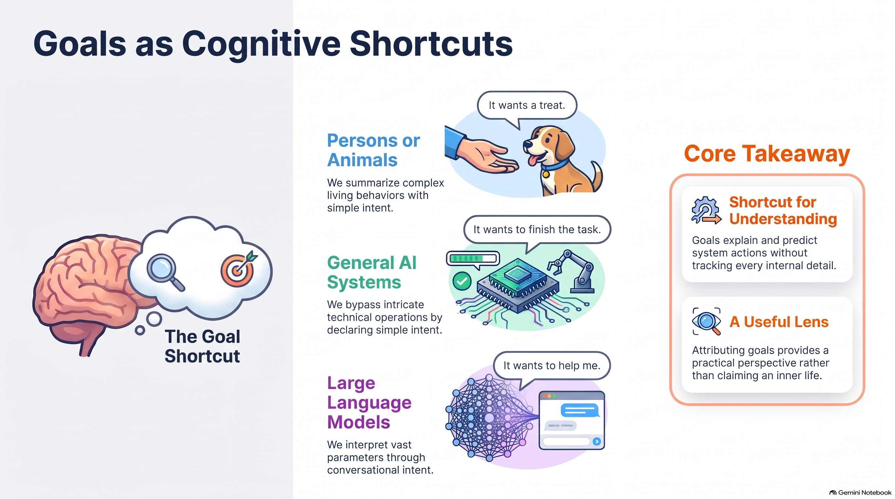

- [Video explaining if AI has goals](https://youtube.com/shorts/cqn-JXic8OY)

When observing complex behaviors in animals or technology, people naturally use goal attribution as a mental shortcut to make sense of what is happening. Instead of tracking intricate internal operations, we assign simple intentions to explain actions—such as assuming a dog "wants a treat," an automated AI system "wants to finish the task," or a large language model "wants to help me". Summarizing complex behaviors and vast parameters into simple intent allows us to easily explain and predict system actions without needing to monitor every underlying technical or biological detail.

While this approach provides a practical lens for making sense of complex systems, attributing a goal is a convenient perspective rather than proof that a system possesses a conscious inner life. Relying too heavily on this shortcut can lead to undesirable outcomes or misleading assumptions, as it is easy to mistake automated computations or basic instincts for genuine human-like motives. Recognizing that goal attribution is merely a useful tool helps us navigate interactions with both animals and AI effectively without misjudging how they truly operate.

